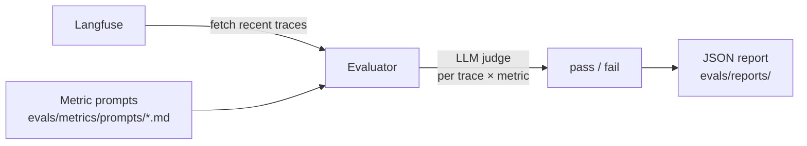

# Evaluation

The template includes a metric-based evaluation framework that fetches traces from Langfuse, scores them with LLM judges, and generates JSON reports.

## Running evaluations

```bash
make eval                        # interactive mode — prompts for settings
make eval-quick                  # runs with defaults, no prompts
make eval-no-report              # runs but skips report generation
make eval ENV=production         # run against production traces
```

## How it works



1. **Fetch traces** — pulls recent LLM traces from Langfuse (configured via `LANGFUSE_*` env vars)
2. **Score** — for each trace × metric combination, an LLM judge evaluates the output and returns pass/fail
3. **Report** — a JSON report with aggregated stats and per-trace results is saved to `evals/reports/`

## Built-in metrics

| Metric | What it checks |
| --- | --- |
| `helpfulness` | Did the response actually help the user? |
| `conciseness` | Was the response appropriately concise? |
| `hallucination` | Did the response contain made-up facts? |
| `relevancy` | Was the response on-topic? |
| `toxicity` | Did the response contain harmful content? |

## Adding a custom metric

1. Create a markdown file in `evals/metrics/prompts/`:

```markdown
# My Metric

Evaluate whether the assistant response...

## Scoring

Return "pass" if... Return "fail" if...
```

2. The evaluator auto-discovers and applies all `.md` files in that directory.

## Report format

Reports are saved to `evals/reports/evaluation_report_YYYYMMDD_HHMMSS.json`:

```json
{
  "summary": {
    "total_traces": 50,
    "success_rate": 0.92,
    "duration_seconds": 34.2
  },
  "metrics": {
    "helpfulness": {"pass": 48, "fail": 2, "rate": 0.96},
    "hallucination": {"pass": 45, "fail": 5, "rate": 0.90}
  },
  "traces": [...]
}
```

## Eval LLM configuration

The judge is **one fixed model** with its own client — it never uses the agent's fallback chain, because switching judges mid-run would make scores incomparable between runs.

```bash
EVALUATION_LLM=gemini-3.5-flash-lite   # default
EVALUATION_BASE_URL=...                # defaults to GEMINI_BASE_URL
EVALUATION_API_KEY=...                 # defaults to GEMINI_API_KEY
EVALUATION_MAX_RPM=12                  # judge calls per minute
EVALUATION_MAX_TRACES=20               # runs per eval (each costs one call per metric)
```

### Free-tier behaviour

- **Throttled:** judge calls are spaced to `EVALUATION_MAX_RPM` (default 12, under the free tier's 15 RPM). Each trace costs one call per metric.
- **Per-minute 429:** waits Google's `retryDelay`, then retries the same judge (tenacity, 3 attempts). 5xx and timeouts back off exponentially.
- **Daily 429:** the run **stops** instead of switching models. The report has `stopped_early: true` and `traces_remaining`. Rerun after the daily reset (midnight Pacific).
- **All-or-nothing per trace:** scores are pushed only when every metric for a trace succeeds, so a trace hit by the daily cap or a persistent 5xx stays unscored and the next run retries it (re-spending those judge calls).
- Only traces from the **last 24 hours** are fetched, newest first, so resume within a day.
- **Langfuse failures stop the run.** Traces are read through v2 observations and v3 scores (`evals/traces.py`), because the legacy endpoints return 410 for organizations created after 2026-09-16. An API error exits non-zero rather than reporting success on zero traces.
- Scores become readable a short time after they're sent, so a rerun straight after a run could re-score a few traces.
- The judge's calls share the daily quota of `EVALUATION_LLM` with the app when they're the same model.
