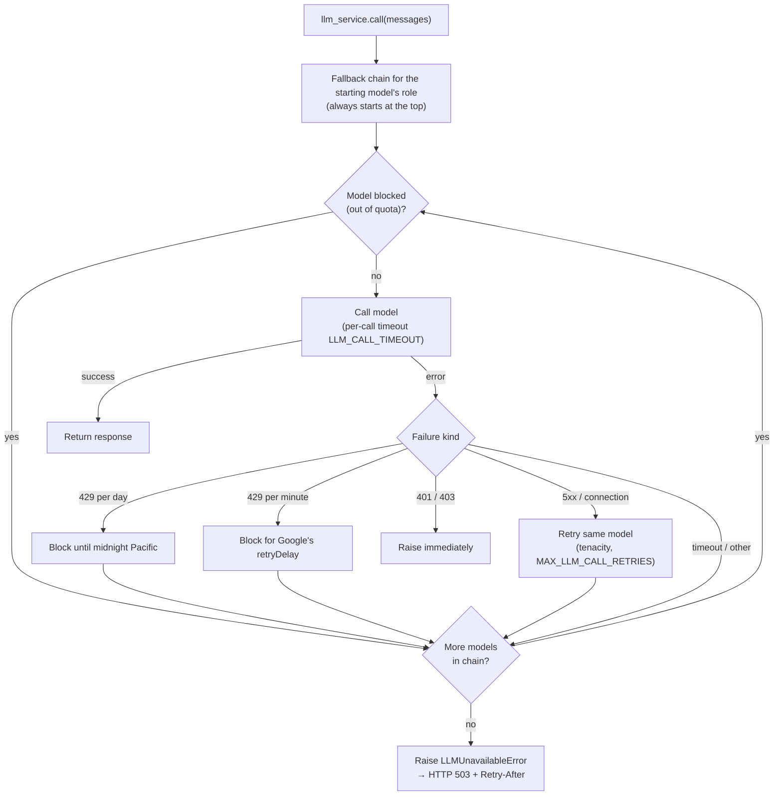

# LLM Service

## Overview

The LLM service (`app/services/llm/`) handles all language model calls with quota-aware fallback, retries for transient errors, and a total timeout budget. Agent code calls `llm_service.call(messages)` — the service handles everything else.

The package is split into four modules:

- `app/services/llm/registry.py` — `LLMRegistry`: providers, models, and their roles
- `app/services/llm/availability.py` — error classification and per-model quota tracking
- `app/services/llm/service.py` — `LLMService`: call logic, retries, fallback, structured output
- `app/services/llm/gemini_chat.py` — `GeminiChatOpenAI`: `ChatOpenAI` plus Gemini's thought signatures

## Providers

Every provider is reached through its **OpenAI-compatible endpoint**, so all models share one client family (`ChatOpenAI`) and one error hierarchy (`openai.RateLimitError`, …). A provider is just a `base_url` plus a key:

```python
# app/services/llm/registry.py
PROVIDERS = {
    "gemini": {"base_url": settings.GEMINI_BASE_URL, "api_key": SecretStr(settings.GEMINI_API_KEY)},
}
```

The default (and only) provider is the **Gemini API free tier** at `https://generativelanguage.googleapis.com/v1beta/openai/`. Adding a second OpenAI-compatible provider means one `PROVIDERS` entry and one key in config.

> **Do not link a billing account** to the Google Cloud project behind your key: that moves it off the free tier and usage becomes paid.

## Model registry

Models are defined in `LLMRegistry.LLM_CONFIGS`. Each entry has a **role**, and fallback only ever moves between models of the same role:

| Name                    | Role         | Free-tier limits (RPM / RPD) | Used for                                |
| ----------------------- | ------------ | ---------------------------- | --------------------------------------- |
| `gemini-3.5-flash-lite` | `agent`      | 15 / 500                     | Default agent model; mem0 fact extraction |
| `gemini-3.1-flash-lite` | `agent`      | 15 / 500                     | Fallback 1 (separate quota)             |
| `gemini-3.8-flash`      | `agent`      | 5 / 20                       | Fallback 2 (last resort)                |
| `gemma-4-31b-it`        | `classifier` | 30 / 14.4K (16K TPM)         | Session titles                          |

Free-tier quotas are **per model and per Google Cloud project** (not per key), so each fallback hop buys fresh capacity. Limits change; check AI Studio for your project's current numbers.

Set `DEFAULT_LLM_MODEL` to choose the agent's starting model, and `SESSION_NAMING_MODEL` for session titles.

**Notes from testing**

- Gemini 3 models return a `thought_signature` on each tool call and reject the next request with a 400 if it isn't sent back. `ChatOpenAI` drops the field, so `GeminiChatOpenAI` (`app/services/llm/gemini_chat.py`) stores it in `additional_kwargs` and restores it in the request. Disabling thinking doesn't remove this requirement. A signature issued by one model is accepted by another, so fallback mid-tool-loop works. Threads with no signature get Google's `skip_thought_signature_validator` value.
- `reasoning` is not set on any entry: in `ChatOpenAI` it switches to OpenAI's Responses API, which Gemini's endpoint does not implement.
- Gemma's thinking cannot be disabled (`reasoning_effort` returns a 400). It spends hidden thinking tokens, can take 3–30 s, and in plain JSON mode leaks a `<thought>` block into the reply. Strict structured output (`response_format=Schema`) comes back clean, which is why session titles work on it.

## Fallback behaviour



| Failure | Detected by | What happens |
| ------- | ----------- | ------------ |
| Daily quota (429) | `QuotaFailure.violations[].quotaId` contains `PerDay` | Model skipped until the daily reset (midnight Pacific) |
| Per-minute quota (429) | any other 429 | Model skipped for `RetryInfo.retryDelay` (60 s if absent) |
| Server error (5xx, connection) | `InternalServerError`, `APIConnectionError` | Retried on the same model, then next model; never blocked |
| Timeout | `APITimeoutError` | Next model, no retry |
| Auth (401 / 403) | `AuthenticationError`, `PermissionDeniedError` | Raised at once — every model shares the key |
| Anything else (400, parse error) | — | Next model |

Key properties:

- **Not sticky, not shared.** Each call starts at the head of its chain; one request's fallback never changes where another request starts.
- **No wasted calls.** A blocked model is skipped without a request. OpenAI-SDK retries are disabled (`max_retries=0`) so the service owns retry policy.
- **Bounded latency.** `LLM_CALL_TIMEOUT` (default 20 s) per call lets a hung model be skipped; `LLM_TOTAL_TIMEOUT` (default 60 s) caps the whole call.
- **Graceful failure.** When no model can serve the call, `LLMUnavailableError` carries `quota_exhausted` and `retry_after_seconds`. `/chat` returns **503** with a `Retry-After` header; `/chat/stream` sends a user-safe final event.

**Known limitation:** fallback between models of one provider handles *quota exhaustion*, not a provider outage, an invalid key, or a policy block — all models fail together then. Cross-provider fallback would need a second `PROVIDERS` entry.

**Process-local state:** blocks live in memory per worker, so with several uvicorn workers each one learns a model is exhausted from its own first 429.

## Tools

Tools are bound once at startup to every model in the default chain:

```python
llm_service.bind_tools(tools)
```

Fallback picks the pre-bound instance for the next model, so tool bindings survive model switches.

## Structured output

Pass a Pydantic model as `response_format` to get a validated instance back instead of a raw `BaseMessage`:

```python
from app.schemas.my_schema import MySchema

result: MySchema = await llm_service.call(
    messages,
    model_name="gemma-4-31b-it",   # optional — uses the default agent model if omitted
    response_format=MySchema,
    max_completion_tokens=256,
)
```

The service chains `.with_structured_output(schema)` on each model it tries, so fallback works transparently. Overrides merge on top of the registry entry's kwargs; the endpoint and key always come from the entry's provider.

## Adding a new model

```python
# app/services/llm/registry.py — LLMRegistry.LLM_CONFIGS
{
    "name": "gemini-3.6-flash",
    "model": "gemini-3.6-flash",      # exact ID from the provider's models list
    "provider": "gemini",
    "role": ROLE_AGENT,
    "kwargs": {"max_completion_tokens": settings.MAX_TOKENS},
},
```

Position within a role sets its fallback order. List the exact model IDs your key can use with:

```bash
curl -s "https://generativelanguage.googleapis.com/v1beta/models" -H "x-goog-api-key: $GEMINI_API_KEY"
```
