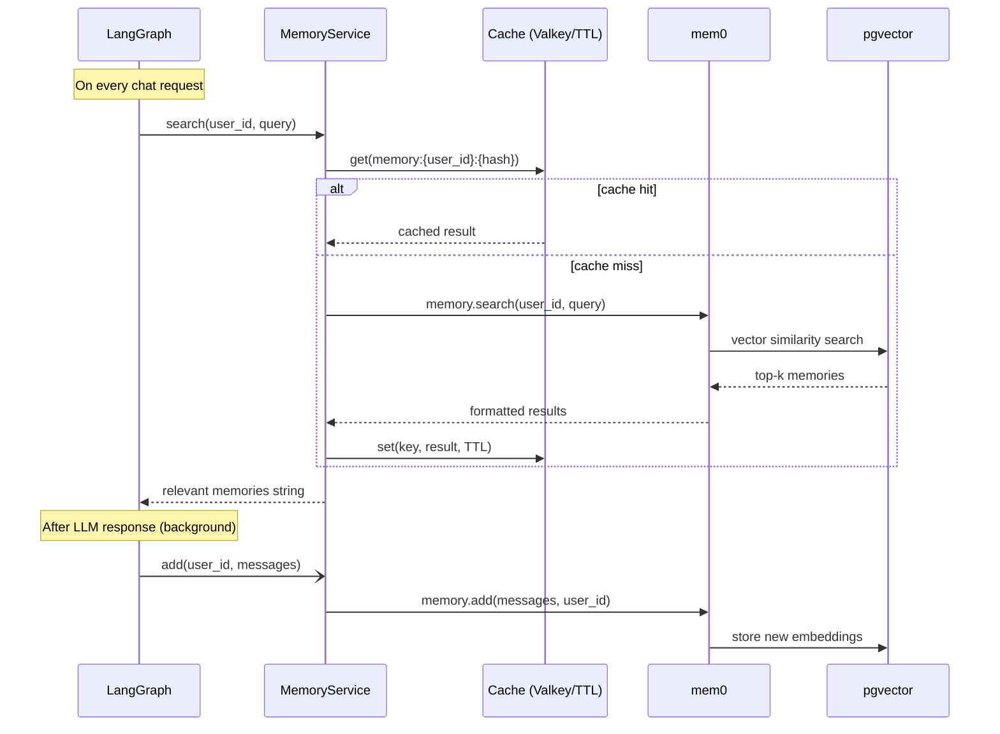

# Memory

## Overview

The template includes a long-term memory system powered by [mem0](https://github.com/mem0ai/mem0) and pgvector. Memories are extracted from conversations, stored as vector embeddings, and retrieved semantically on each request — giving the agent context from past sessions.

## How it works



## Cache layer

Memory search results are cached to avoid repeated pgvector queries for similar questions within the same TTL window.

- **With Valkey/Redis**: cache is shared across app instances. Set `VALKEY_HOST` in your `.env`.
- **Without Valkey**: falls back to an in-memory `TTLCache` — works fine for single instances.

Cache key: `memory:{user_id}:{sha256(query)[:16]}`
TTL: `CACHE_TTL_SECONDS` (default: 60s)

Only successful, non-empty results are cached. Errors are never cached.

## Memory updates

After the LLM produces a response, memories are updated **in the background** via `asyncio.create_task`. This means:
- The response is returned immediately, without waiting for mem0 to finish
- Memory updates don't block or slow down the chat response

## Configuration

| Variable | Default | Description |
| --- | --- | --- |
| `LONG_TERM_MEMORY_COLLECTION_NAME` | `longterm_memory` | pgvector collection name |
| `LONG_TERM_MEMORY_MODEL` | `gemini-3.5-flash-lite` | Registry model used by mem0 to extract and process memories |
| `LONG_TERM_MEMORY_EMBEDDER_MODEL` | `gemini-embedding-2` | Embedding model for semantic search |
| `LONG_TERM_MEMORY_EMBEDDING_DIMS` | `1536` | Embedding size stored in pgvector (≤ 2000) |
| `CACHE_TTL_SECONDS` | `60` | Memory search cache TTL |

## Running mem0 on Gemini

mem0 runs in-process and stores everything in your PostgreSQL — there is no mem0 account. Its model calls go to Gemini (see `build_mem0_config()` in `app/services/memory.py`):

- **Fact extraction** uses mem0's `langchain` provider with the registry's model instance. mem0's `openai` provider can't be used: it always sends OpenAI's `store` field, which Gemini rejects with a 400. JSON mode is set on the model itself because the `langchain` provider ignores mem0's `response_format`.
- **Model choice:** Flash Lite, not Gemma. Gemma's thinking can't be disabled, takes up to ~30 s, and leaks a `<thought>` block that mem0 can't parse. The cost is 1–2 calls per chat turn from the agent model's daily quota.
- **Embeddings** use `gemini-embedding-2` truncated to **1536** dimensions (it returns 3072 by default). mem0 always builds an HNSW index, and pgvector's HNSW index rejects `vector` columns wider than 2000.
- **Changing the dimension** requires dropping the collection table — mem0 creates it once and never alters it:

  ```sql
  DROP TABLE IF EXISTS longterm_memory;
  ```

- **Telemetry:** mem0 sends usage events to PostHog unless `MEM0_TELEMETRY=False` (set in `.env.example`).

## Startup pre-warming

At startup, `memory_service.initialize()` is called in the app lifespan. This establishes the pgvector connection pool and runs mem0's schema check, so the first user request doesn't pay the ~130ms cold-init cost.

## Per-user isolation

Each user's memories are stored and searched independently using `user_id` as the namespace. Users cannot access each other's memories.
